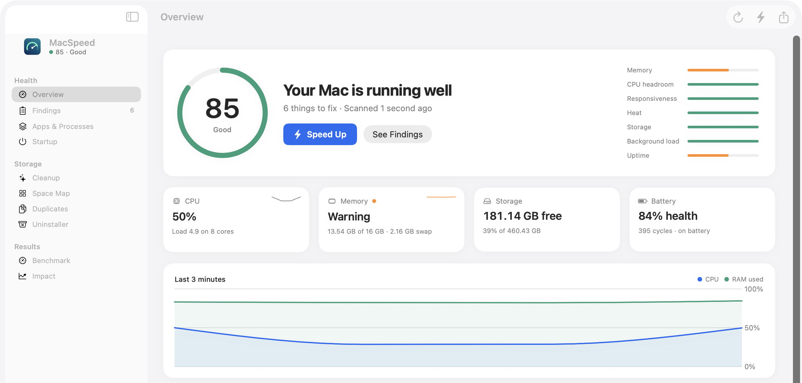

# MacSpeed

Find what's actually slowing your Mac, fix it in one click, and measure whether the fix helped.

**[Download the free beta](https://github.com/aaubin649/macspeed/releases/latest/download/MacSpeed-Beta.dmg)** · [Website](https://aaubin649.github.io/macspeed/) · [Send feedback](https://github.com/aaubin649/macspeed/issues/new/choose)

- **Finds the cause:** CPU per app, memory pressure, swap, heat, responsiveness and startup items, with the evidence for every finding
- **Fixes it safely:** quit the app hogging memory, disable leftovers from deleted apps, clear caches apps rebuild. Everything is restorable or goes to the Trash
- **Proves it:** memory, swap and CPU measured before and after each fix
- **Also:** Space Map, Duplicates, Uninstaller, Benchmark, menu bar monitor

macOS 14 or later, Apple silicon and Intel. Scanning asks for no permissions, and nothing you measure leaves your Mac. The only network request is an anonymous daily update check, which you can turn off.

The beta isn't signed by Apple yet, so macOS asks you to confirm once: open it, click Done, then System Settings > Privacy & Security > Open Anyway.

This repository hosts the website and the beta download.
